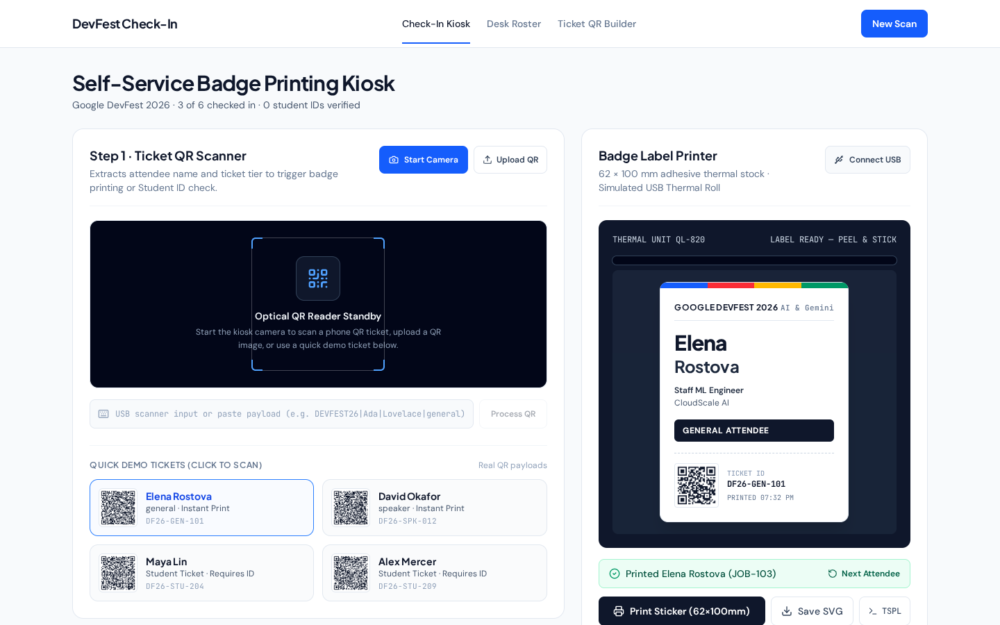
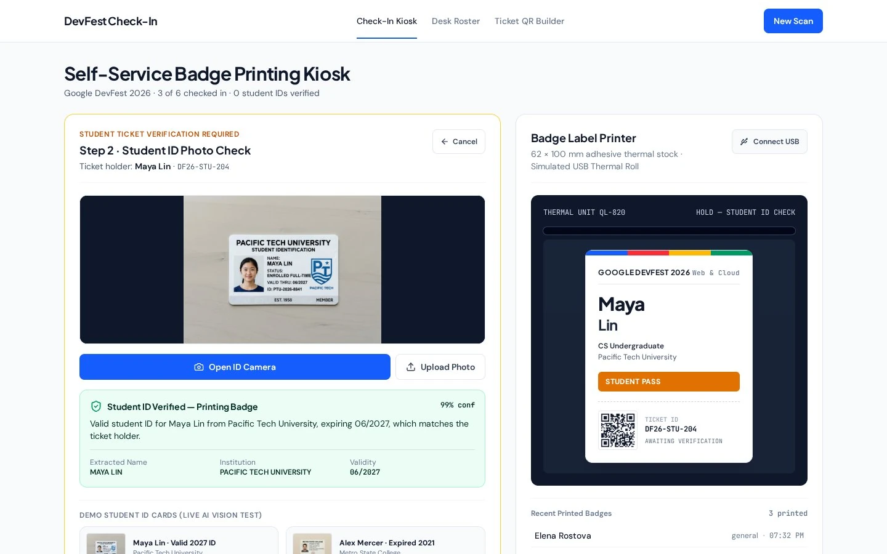
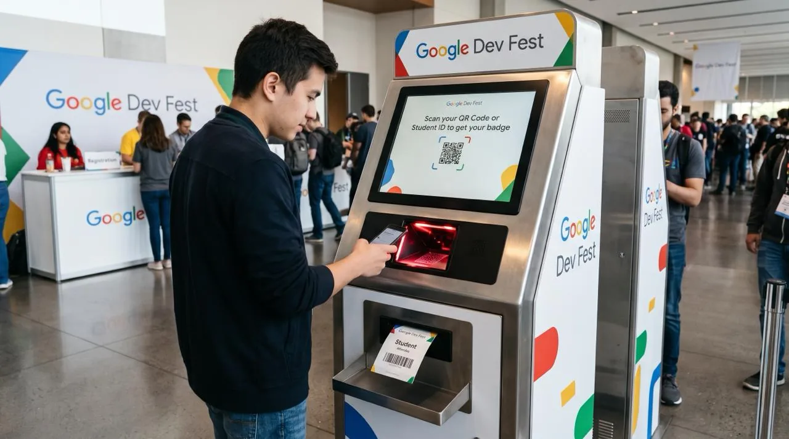

# DevFest Badge Kiosk

At DevFest Toronto, we had a simple task: solve an annoyance you faced at the event. We immediately thought of registration, where hundreds of people swarm dozens of volunteers who have to search for each person's badge by hand. We built a kiosk that scans your QR ticket, pulls your details from it, asks for proof of student ID if your ticket needs it, and prints your badge on the spot.

<p align="center">
  
  
</p>

We bootstrapped the app with Google AI Studio in under 15 minutes. The goal was to present a working app at the end of the session, so time was our main constraint: we had to write a prompt that would get us there as fast as possible while sacrificing as little quality and depth as we could. In the live demo, we scanned a QR ticket we’d generated and added to Apple Wallet, the same way an attendee would show it at the door.

By the end of the session, the app could:

- Scan QR tickets from a webcam, an uploaded image, a USB barcode scanner, or manual entry. Demo tickets are built in.
- Ask for a photo and verify a student ID if the ticket belongs to a student. If a mismatch happens, a volunteer can override it.
- Preview the badge label and print it: browser print, SVG download, or straight to a USB thermal printer.
- Give organizers an attendee roster (check-in status, search, reprints) and a QR ticket builder.

## Quick Start

**Prerequisites:**

- Node.js v22.18 or newer
- A Gemini API key from https://aistudio.google.com/apikey (only needed for the student ID check)

```bash
npm install
cp .env.example .env    # add GEMINI_API_KEY
npm run dev             # http://localhost:3000
```

To try it, click one of the demo tickets. For the student flow, pick the student ticket and test with the built-in sample IDs (one valid, one expired).

## Known Limitations And Possible Improvements

We built this in 15 minutes for a demo, so:

- All data lives in memory and starts from demo attendees. Restarting the server wipes every check-in.
- The API has no login. Anyone who can reach the server can check people in.
- The server trusts the student ID result sent by the browser, so anyone calling the API directly can skip the check.

What we'd add next:

- A real database instead of in-memory data
- Staff login, with the override moved to the server and logged
- Importing the attendee list from the ticketing platform

## Team

Built by [Vladimir Popovich](https://github.com/popovichv) and [Andrei Veremeenko](https://github.com/verevkaa) at DevFest Toronto 2026.

This is a community project, not affiliated with Google or Google Developer Groups. All names, tickets and ID cards in the demo data are fictional.

<p align="center">
  
</p>
